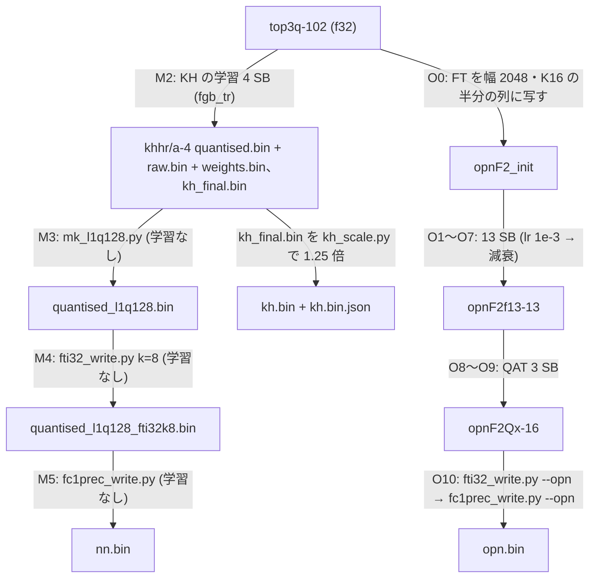
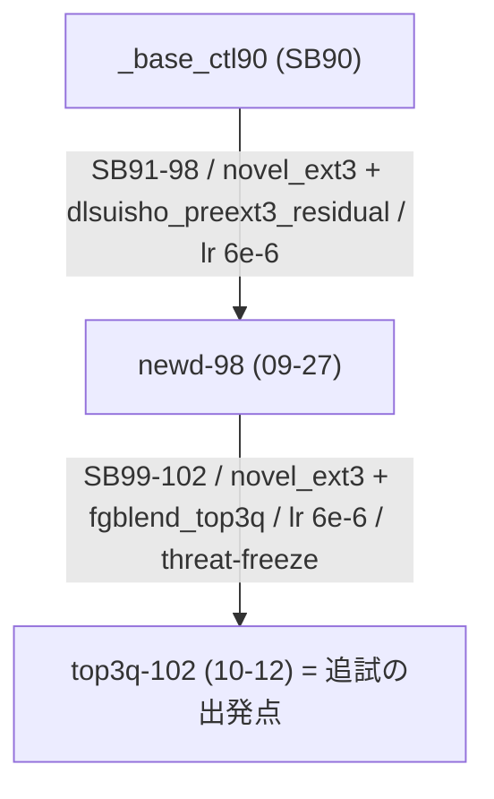

# 学習の追試の手順書

公開物と公開データで、 配布する評価関数 3 点 (本体 `nn.bin`、 `kh.bin`、 `opn.bin`) を作り直す手順です。 何も無いところから始める手順は `TRAINING_FROM_SCRATCH.md` にあります。 この文書は、 我々が実際に通った道を、 配布した出発点から追う人のためのものです。

- **出発点**: `top3q-102` の f32 重み。 それより前の系譜 (7〜10 月の約 100 SB) は 9 章の系譜図だけです。
- **同じ値にはなりません** (8 章)。 合否は「篩の値が許容幅に入るか」で見ます。
- コマンドは**我々が実際に走らせたものの写し**です (各 run の `experiment.json` と起動スクリプトから)。 手順書どおりの通し再現はまだ誰もしていません。 `<…>` は追試者の環境のパスです。
- 未確定の箇所は **[未]** と書きました。 一覧は 11 章。

## 0. 全体の流れ



| 段 | GPU 時間 (我々の実績) |
|---|---:|
| M2 (KH) | 3.5 時間 |
| M3〜M5 (書き直し 3 段)、 KH の倍率 | 0 (CPU で数秒〜数分) |
| O0〜O9 (OPN) | 16.4 時間 |
| 篩 (1 net あたり、 CPU) | 約 6 分 |

## 1. 必要なもの

| 項目 | 我々の環境 | 備考 |
|---|---|---|
| GPU | NVIDIA GeForce GTX 1050 Ti (VRAM 4 GB) | 4 GB で全段が回った。 本体の KH 段は threat の群化で GPU メモリを `--threat-group-mem-budget-mib 1200` に抑えた |
| 速さ | 本体 約 52 分 / SB、 OPN 約 55 分 / SB (約 30,000 局面 / 秒)。 1 SB = 100,003,840 局面 (4096 x 24415) | |
| CPU の後処理 | python 3 + numpy (照合には cshogi も) | L1Q128 の書き出し 数秒、 篩 1 net 約 6 分、 照合 14 秒 |
| ディスク | OPN の教師 67.9 GB、 本体の教師 7.9 GB、 OPN の抽出元 17 本 (各 約 11.5 GB)、 checkpoint 1 個 約 1.7 GB | 途中の checkpoint は消してよい |
| OS / ツール | Windows 10、 Git Bash、 Rust [未: 版]、 CUDA [未: 版]、 numpy [未: 版] | |
| 学習器 | `<trainer>` (https://github.com/pekoshi/bullet-shogi の `p2shogi` ブランチ) を既定 feature (`cuda`) でビルド: `cargo build --release -p bullet_lib --example shogi_layerstack` | 道具のリポジトリ (https://github.com/pekoshi/rshogi の `p2shogi` ブランチ) を同じ親フォルダに `rshogi` という名前で置く (`rshogi-core` を相対パスで参照する) |
| PSV の抽出 | `cargo build --release -p bullet_lib --example psv_bucket_filter` | |
| python の器 | `<tools>/tools/python/` (12 章の一覧) | |

我々は 3 つの時点のビルド (KH 段 / OPN / OPN の QAT) を使い分けましたが、 機能は引数で切り替わるので、 公開版の 1 本で全段を回せるはずです [未: 公開版のビルドで、 M2 と O1 の起動直後のログが 4 章・6 章の期待と一致することを確かめる]。

## 2. データの入手

データは同梱しません。

| 用途 | データ | 入手元 | 確認値 |
|---|---|---|---|
| OPN の教師 | DL 水匠のラベルを付けた蒸留データ 001〜018 (ponkotsu) | Hugging Face `ngs436/dlsuisho-ponkotsu-distilled` (`penguinkumimanu/ponkotsuWCSC36` の 001-018 と sha256 一致、 と記録) | shard ごとの sha256 [未]。 利用条件はデータの配布元に従う |
| 本体 KH 段の教師 | `fgb_tr.psv` (198,007,603 局面) | 自作: 土台の教師 + floodgate 上位陣の棋譜から作った局面の注入 (`fgblend_top3q.psv` 200,007,680 局面を train / val に分けたもの) | 🚨**第三者の棋譜と教師に由来するため配布しない**。 代わりの公開データで追試すると値は変わる |
| 進行度の係数 | `progress.bin` (NAGISA v3.1、 GPLv3) | 我々の Releases に同梱 | sha256 `e7ed0eef88868335f9a46c58a121dccb5ad82a5eb1c8ee12de90365ab351e37d` |
| 出発点 | `top3q-102` の `optimiser_state/weights.bin` (f32) と `raw.bin` | [未: 配布の可否と場所] | `quantised.bin` の sha256 `687a36033f689e37085381f14de11c242bff17c899ebf012a326ea3a6ef9c1b4` |

## 3. 前処理 (OPN の教師)

### 3.1 既に学習した局面を除く (任意)

我々は各 shard から、 本体の系譜で既に見た 55.8 億局面を Bloom フィルタで除きました (`ponko_novel.py`、 既見率 0.40)。 追試者はこの系譜のデータを持たないので、 **この段は飛ばして shard をそのまま使います** (局面数が約 1.67 倍になり、 同じ SB 数だと 1 周に届かない)。 値への影響は [未]。

### 3.2 score の換算 (必須)

ponko の値を我々の目盛りに合わせる換算表を当てます (`calib_lut.py`: ponko の値 p ごとに E[σ(d/600) | p] を求め、 600·logit で score に戻す)。 当てた shard には `.calib` の印を置き、 2 重に当てません。 表の作り方 (何と対応づけたか) の詳細は [未]。

### 3.3 序盤帯 (bucket 0-2) の抜き出し

```bash
psv_bucket_filter.exe --in "<ponko_002.psv>,…,<ponko_018.psv>" \
  --out <ponko_early>/ponko_b02_all.psv --bucket-min 0 --bucket-max 2 \
  --bucket-mode progress8kpabs --progress-coeff <progress.bin> --threads 8
```

我々の結果: 読んだ 4,974,820,631 / 通した **1,697,493,603** (34.1%) / bucket 0〜7 の分布 `703624724, 566829455, 427039424, 402662305, 471578689, 684122564, 1079116223, 639847247` / 学習器の bucket の計算との照合 77,731,582 件で不一致 0 / 2,375 秒。 3.1 を飛ばすと総数は変わりますが、 **bucket 0-2 の比 (41.4% : 33.4% : 25.2%) は近いはず**です。

学習の起動時にも検査値が出ます: 先頭 262,144 局面で `b0=108654 b1=87587 b2=65903 b3..b7=0`。

## 4. 本体: KH の学習 (M2)

```bash
shogi_layerstack.exe --data <fgb_tr.psv> --data-format psv --interleave-file-batches 1 \
  --resume <top3q-102> --start-superbatch 0 --superbatches 4 --batches-per-superbatch 24415 --save-rate 1 \
  --batch-size 4096 --lr 0.000006 --warmup-batches 500 --lr-gamma 1.0 --lr-step 1 \
  --wdl 0.15 --scale 600 --loss-power 2.6 --l0 1024 --l1 16 --l2 64 --psqt \
  --threat --threat-out 64 --threat-freeze-hard --bucket-mode progress8kpabs --progress-coeff <progress.bin> \
  --output-format rshogi --optimizer ranger21 --weight-decay 0.005 --ranger21-lookahead-mergetime 20 --ranger21-total-steps 0 \
  --threat-bucket-groups 0,1,1,2,2,3,3,3 --threat-group-mem-budget-mib 1200 \
  --kh --kh-feats h --kh-freeze-rest --kh-unfreeze-fc0 --kh-lr-mult 64 --kh-dump <out>/kh_final.bin \
  --output <out> --net-id a
```

- 何をしているか: FT・threat・fc1・fc2・PSQT を凍結し、 KH (浮き駒 78 次元 → 64 列) と fc0 だけを学習。 KH の lr は 64 倍。
- 起動直後に確かめる行: `KH ブロック: 部分 h / 出力幅 64 …`、 `Features: HalfKA_hm (73305 dimensions)`、 `Threat: enabled (profile=full, 216720 dimensions …)`、 `threat_ft HARD FREEZE`、 `KH FREEZE-REST: […]`、 `Resuming from checkpoint: …/top3q-102`、 `WDL lambda: Constant (0.15)`。
- 出力: `<out>/a-4/quantised.bin` (133,289,134 B)、 `a-4/raw.bin`、 `a-4/optimiser_state/weights.bin`、 `kh_final.bin` (36,352 B) と `kh_final.bin.json` (dims 142 = k 64 + h 78)。
- 期待値と許容幅:

| 指標 | 我々の値 | 許容幅 (案) |
|---|---|---|
| running loss (SB1〜4) | 0.008452 / 0.008366 / 0.008418 / 0.008342 | ±0.0001 [推: SB 間の揺れが 0.0001 程度] |
| `kh_final.bin.json` の l2_norm | 6.923 | 参考 |
| 篩 bucket 0-2 (net + KH) | 0.2900 (出発点 top3q-102 は 0.2829) | ±0.011 (2σ、 8 章) |
| 篩 KH の on − off (同じ net、 KH の有無) | bucket 0〜2 +0.0055 ±0.0022 / 3〜7 +0.0048 ±0.0009 | 符号が正で、 3〜7 が +0.003 以上 |
| NPS の税 (KH あり / なし) | −0.34% [−0.93, +0.26] (64 周) | 区間の下端が −1.5% を下回らない |

- 所要: 12,552 秒 (3.5 時間)。
- 注意: loss だけでは KH の効きは読めません (篩の on / off で見る)。

### 4.1 KH の倍率 (配布の kh.bin)

配布の `kh.bin` は `kh_final.bin` の重みを 1.25 倍したものです (11-17 の決定)。

```bash
py -3 kh_scale.py 1.25      # kh_final.bin -> kh_x125.bin (+ .json に kh_scale_a = 1.25)
```

- 器は先に a = 1.0 で元とバイト一致することを確かめ、 エンジンと同じ丸め (254 倍して 0 から遠い方) で i16 を超えないかを調べてから書きます。 [未: 入出力のパスがスクリプトの中に書いてある。 公開版で引数にする]
- 配布名は `kh.bin` / `kh.bin.json`。

## 5. 本体: 書き直し 3 段 (学習なし)

### 5.1 L1Q128 (M3)

```bash
py -3 mk_l1q128.py <out>/a-4/quantised.bin <out>/a-4/raw.bin -                         # 自己検算と表示だけ
py -3 mk_l1q128.py <out>/a-4/quantised.bin <out>/a-4/raw.bin <out>/a-4/quantised_l1q128.bin
```

- fc0 の本体 15 行 x 8 bucket を raw.bin (f32) から 1/128 刻み (i8、 飽和させる)、 bias を 1/16256 刻みで書き直し、 arch の 3 番目の token を `AffineTransformL1Q128[16<-2048]` に。 他は写すだけ。 丸めは 0 から遠い方。
- 期待値: 自己検算 OK (現行の式での作り直しが元と全バイト一致) / 飽和 13 本 / 122,880 本 / 大きさ +6 B。 追試の net では飽和の本数は変わります。 **桁違いに増えたら (目安 100 本超) 止めて調べる**。
- 照合: `py -3 engcheck.py <exe> <quantised_l1q128.bin> <ラベル> 128` で、 エンジンの `eval` と python の整数推論が全局面で不一致 0 (我々は 130,965 局面)。 この照合は 11-16 の形式 (FT の刻み 254) の exe で行いました。
- 篩 (L1Q128 − 刻み 64、 `screen128.py`): bucket 2-7 **+0.0027 ±0.0009** / 3-7 +0.0029 ±0.0009 / 0-1 +0.0070 ±0.0036。 bucket 3 だけ −0.0021 ±0.0022。 許容: 2-7 の差が 0 以上。
- **bit 単位で再現できる段**: 入力が我々の `a-4/quantised.bin` + `raw.bin` なら、 出力の sha256 は `b58157e48d144e94e05171094659ed9df1e6eba5ec82d13b9c0bd74ba2e9fa3a` になります。

### 5.2 FT を 8 倍細かい刻みに (M4)

```bash
py -3 fti32_write.py <out>/a-4/quantised_l1q128.bin <out>/a-4/optimiser_state/weights.bin 8 <out>/a-4/quantised_l1q128_fti32k8.bin
```

- FT の LEB128 ブロックだけを、 weights.bin の `l0w` / `l0b` から作った 8 倍刻みの値 (重み = round(float32(254·8)·l0w)、 bias = round(254·8·l0b)) に差し替えます。 arch の FT 幅の前に `I32K8:` を入れ (`[73305->I32K8:1024x2]`)、 版番号を 0x7AF32F21 にします。 PSQT 以降は 1 byte も変えません。 i16 に入らない値があれば止まります (我々の net では FT の重みの最大 |q| 3,691)。
- `--check <元 quantised.bin> <weights.bin>` で、 k=1 の量子化が元の net の FT と一致するかだけを見られます (weights.bin の取り違えの関門)。
- エンジンは `-DP2_FT_KS=3 -DP2_FT_OUT16=5` (公開版は加えて `-DP2_FT_SPARSE16`) でビルドしたものを使います。

### 5.3 fc1 以降の丸めを細かく (M5)

```bash
py -3 fc1prec_write.py <out>/a-4/quantised_l1q128_fti32k8.bin <out>/a-4/optimiser_state/weights.bin <nn.bin>
```

- 末尾の bucket (head) 8 個のうち fc1 の重み (clip(round(128·l2w), −127, 127))、 fc1 の bias (round(65024·l2b))、 fc2 の bias (round(32512·l3b)) だけを weights.bin の f32 から作り直します。 書き換える前に、 元の値が同じ式の刻み 64 版と 1 つ残らず一致するかを確かめます (一致しなければ区画の位置か net の取り違え)。 fc1 の token を `AffineTransformF1P128[` にし、 版を 0x7AF32F22 にします。
- 期待値: fc1 の重みで切られる数 0 (我々は max|q| 88)、 元の値の照合で不一致 0、 大きさ +6 byte (我々は 158,137,921 → 158,137,927 byte)。
- 照合: `fc1p_verify.py` で python の整数模擬とエンジン (`-DP2_FC1_PREC` 入りの exe) の静的評価を比べ、 1,000 局面で完全一致 (我々の結果)。 引数は [未: スクリプトの usage を参照]。
- 我々の `nn.bin` の sha256 は `a83bf75edf0db2bea08ede4b92ac721b383e589caeffdfcf49652a43f067af79` です (M2 の出力が我々のものなら、 5.1〜5.3 は bit 単位で再現できるはず)。

## 6. OPN

### 6.1 初期重み (O0)

```bash
py -3 f1_transplant2048.py build    # [未] 入出力のパスを引数にする
py -3 f1_transplant2048.py verify
```

top3q-102 の f32 の FT (l0w [73,305 x 1024] / l0b) を、 幅 2048・K16 入力 (27,693 行 = 26,064 + factoriser 1,629) の半分の列に写します: 列 j < 512 → j、 j + 512 → j + 1024。 行は K16 の 7〜9 段の 15 区分をそのまま、 他の 30 区分は f32 の平均。 写した列の factoriser 行は 0。 残り 1,024 列は N(0, 0.25)、 bias 0 (seed 20261115)。 後段は学習器の初期化に任せます。

一から学習した幅 2048 は同じ 2 SB で篩 0.2050、 写しから始めると 0.2756 でした。

### 6.2 学習 (O1〜O9)

共通の引数:

```bash
shogi_layerstack.exe --data <ponko_b02_all.psv> --data-format psv --bucket-filter 0-2 \
  --batch-size 4096 --batches-per-superbatch 24415 --save-rate 1 --log-rate 256 --threads 3 \
  --warmup-batches 500 --lr-gamma 1.0 --lr-step 1 --wdl 0 --scale 600 --loss-power 2.6 \
  --l0 2048 --l1 16 --l2 32 --factorise --bucket-mode progress8kpabs --progress-coeff <progress.bin> \
  --opn-king16 --loss-scale 300 \
  --output-format rshogi --optimizer ranger21 --weight-decay 0.005 --ranger21-lookahead-mergetime 20 --ranger21-total-steps 0 \
  --superbatches <END> --start-superbatch <START> --lr <LR> <入力> [--qat] --output <out>/<NID> --net-id <NID>
```

| 段 | NID | START→END | LR | 入力 | --qat | 我々の所要 |
|---|---|---|---|---|---|---:|
| O1 | opnF2 | 1→2 | 0.001 | `--resume-weights-only <opnF2_init/optimiser_state>` | | 9,888 s |
| O2 | opnF2b3 | 3→6 | 0.001 | `--resume <opnF2/opnF2-2>` | | 12,899 s |
| O3 | opnF2b7 | 7→10 (篩の最高の SB を採る。 我々は SB9) | 0.001 | `--resume <opnF2b3/opnF2b3-6>` | | 12,905 s |
| O4 | opnF2f10 | 10→10 | 0.0005 | `--resume <opnF2b7/opnF2b7-9>` | | 3,330 s |
| O5 | opnF2f11 | 11→11 | 0.00025 | `--resume <opnF2f10/opnF2f10-10>` | | 3,266 s |
| O6 | opnF2f12 | 12→12 | 0.000125 | `--resume <opnF2f11/opnF2f11-11>` | | 3,329 s |
| O7 | opnF2f13 | 13→13 | 0.0000625 | `--resume <opnF2f12/opnF2f12-12>` | | 3,259 s |
| O8 | opnF2Q | 14→15 | 0.0001 | `--resume <opnF2f13/opnF2f13-13>` | ○ | 6,662 s |
| O9 | opnF2Qx | 16→16 | 0.0001 | `--resume <opnF2Q/opnF2Q-15>` | ○ | 3,349 s |

- lr の減衰を 1 SB ずつ起動し直しているのは、 学習器の減衰が SB の絶対番号で決まるためです。 `--lr-gamma 1.0` のまま lr を引数で下げます。
- O3 の規則: SB7〜10 を回し、 bucket 0-1 の篩が最高値から 0.012 以上落ちたら止めて最高の SB を採る。 どの SB が最高かは揺れで変わります (我々は SB9 0.2993 → SB10 0.2818)。
- 起動直後に確かめる行 (O1): `Features: HalfKA_hmK16 (27693 dimensions)`、 `Architecture: LayerStack L0=2048, L1=16 (15 effective + 1 skip), L2=32`、 `PSQT shortcut: disabled`、 `Threat: disabled`、 `Loss scale: target = sigmoid(score / 300), pred = sigmoid(out * 2)`、 `Loading graph weights only; optimiser state is new: …`、 `BUCKET-FILTER 先読みの bucket 分布: …`。 QAT の段は `QAT: FT 積 Q=127 切り捨て / L1・L2・L3 の重み Q=64 四捨五入 …`。
- `[warn] --bucket-filter を --hard-freeze-shared なしで使っている` は OPN では意図どおりです (OPN は bucket 0-2 でしか使わない)。

### 6.3 期待値と許容幅

| SB | running loss | 篩 G1 (bucket 0-2) | 篩 b01 (bucket 0-1) |
|---:|---:|---:|---:|
| 2 | 0.015215 | 0.2888 | 0.2758 |
| 6 | 0.013711 | 0.3006 | 0.2899 |
| 9 | 0.013378 | 0.3114 | 0.2993 |
| 13 (減衰後) | 0.011826 | 0.3137 | 0.3010 |
| 15 (QAT) | 0.011832 | 0.3126 | 0.3006 |
| **16 (QAT、 最終)** | **0.011806** | **0.3139** | **0.3019** |

- 合否の案: 最終の b01 が **0.302 ±0.011** (2σ)、 かつ同じ篩での本体 (0.2555) との差が **+0.035 以上**。
- QAT の効果 (QAT − QAT なし) は +0.0018〜+0.0020 ±0.0023 で 2SD を超えていません。 **追試で QAT の差が出なくても不合格ではありません**。
- SB17〜20 まで続けた版は b01 0.2996〜0.3043 で、 伸びは揺れの内でした。

### 6.4 書き直し (O10、 学習なし)

本体と同じ 2 段を `--opn` で当てます。

```bash
py -3 fti32_write.py --opn <opnF2Qx-16>/quantised.bin <opnF2Qx-16>/optimiser_state/weights.bin 8 <opnF2Qx-16>/quantised_fti32k8.bin
py -3 fc1prec_write.py --opn <opnF2Qx-16>/quantised_fti32k8.bin <opnF2Qx-16>/optimiser_state/weights.bin <opn.bin>
```

- OPN の FT は K16 + 因子行で、 `l0w` の先頭 1,629 行 (factoriser) を各区分に足してから量子化します。
- 期待値: fc1 の重みで切られる数 0 (我々は max|q| 124)、 大きさ 92,115,226 → 92,115,232 byte。 照合は `fc1p_verify_opn.py` で 1,000 局面完全一致 (我々の結果)。
- 我々の `opn.bin` の sha256 は `e8ecccd6aa2d64f4347a1222fcc265ceac814565a3c1fcad9f2a028a627db732` です。

### 6.5 エンジンに渡す目盛りと継ぎ目

OPN の出力の目盛り `OPN_Scale0..2` は篩の 1/SD 比から作ります (`calib_l1q128.py`)。 v9 の既定は `OPN_ProgHi=-1946` / `OPN_ProgWidth=0` / `OPN_LambdaMax=256` / `OPN_Scale0=1196` で、 OPN は進行度 bucket 0 だけを受け持ちます。 書き直し 2 段の後に目盛りを測り直しましたが、 SD 比の変化は ±3% の内で、 値は変えていません。

## 7. 篩と検査

| 器 | 何を出すか |
|---|---|
| `opn_static2.py net <ラベル> <quantised.bin>` | OPN の python 順伝播 (エンジン不要) |
| `screen_future.py <ラベル> <net>` | 静的評価が「10 手先の両エンジン 1 秒探索の平均」を当てる順位相関 (手番ごとに計算して平均)。 bucket 0-2 単独 = G1 |
| `b01_screen.py` / `pair_screen.py <A> <B>` | bucket 0-1 の値、 2 本の対の差と 2SD (局単位の bootstrap 400 回) |
| `screen128.py` | 本体の帯別 (0-1 / 2 / 3 / 4-7 / 2-7 / 3-7) |
| `screen_kh_onoff.py` | KH の on − off |
| `engcheck.py`、 `fti32_verify.py`、 `fc1p_verify.py`、 `fc1p_verify_opn.py` | エンジンの静的評価と python の整数推論の全局面一致 |

🚨**篩の局面集 (130,965 局面) は対 NAGISA v4 の対局から取った局面と、 v4 と我々の探索値でできています**。 相手 (v4) の探索出力を含むので、 **篩の正解値は同梱しません**。 追試者は (a) 局面を自分の対局から取り、 正解値を 2 つのエンジンを 1 秒ずつ回して作るか、 (b) 自分のエンジンの探索値だけで篩を作り直す必要があります。 どちらでも本書の期待値はそのまま使えず、 同じ篩の上での差 (A − B) で見ることになります。

最後の確認は対局です。 ただし篩で見える大きさ (+0.003 など) は数百局の対局では見えません (2SE が ±5〜13pt)。 篩は参考程度に使い、 篩の差で勝敗を予想しないでください (`TECHNICAL_NOTES.md` 4 章)。

## 8. 再現性について

- **seed**: 学習器が受ける seed は `--file-shuffle-seed` (既定 0、 record shuffle に使う) だけで、 全段で既定のままです。 学習器自身の重みの初期化 (OPN の後段) と GPU の演算順は固定していません [未: 初期化の seed の扱い]。 OPN の初期 FT の乱数だけは seed 20261115 で決まります。 → **学習の段は bit 単位では再現できません**。
- bit 単位で再現できるのは、 書き直しの段 (M3〜M5、 O10) と、 同じ numpy での O0 (FT の写し) です。
- 許容幅の根拠: 篩の SB ごとの揺れ sd 0.0055、 2σ = 0.0111 (split-half の 11 倍)。 対の差の 2SD は pair_screen が出す値 (OPN どうしで ±0.0023)。
- 学習に使った exe は未 commit の作業ツリーからのビルドで、 各時点のソース全体は残っていません (`CHANGES_FROM_UPSTREAM_trainer.md` 10 章)。

## 9. 出発点より前の系譜



それ以前 (7〜9 月の約 90 SB) の系譜は実験記録 (非公開) にしか残っていません。 各段の共通の引数は `TRAINING_FROM_SCRATCH.md` 4 章に写しました。

## 10. よくある失敗 (記録にあるもの)

- **存在しない引数で即落ちる** (`--end-superbatch` は無い。 終わりは `--superbatches`)。 落ちると GPU が空転します。 起動 90 秒後に `Features` の行と resume の行を見る。
- **Ranger21 の resume で lr が 0 になる**: `--ranger21-total-steps 0` を付ける。 全段で付けています。
- **`--bucket-filter` を `--hard-freeze-shared` なしで使うと範囲外の bucket の評価も変わる** (学習器が警告を出す)。 本体には不可、 OPN では意図どおり。
- **FT を大きく動かすと弱くなる / 一から学習は追いつけない** (実験済み)。 本体は FT を凍結して fc0 と KH だけ、 OPN は本体の FT を写して始める。
- **record shuffle は 256 MB のチャンク内**。 ファイルの並びの偏りは消えません。
- **古い exe に新しい形式の net を渡すと止まる** (意図どおり)。 L1Q128 / FTI32K8 / F1P128 のどれも、 対応していない exe は読み込みで止まります。
- **書き直しに渡す weights.bin を取り違えると、 値が黙って狂う**。 `fti32_write.py --check` と、 `fc1prec_write.py` の「元の値の照合」が関門です。
- **学習と CPU の重い対局・判定を並行させると GPU が 0% になる**。 我々は学習器を低い優先度、 データのスレッド 3 本にしました。
- **篩の SB ごとの揺れは大きい** (2σ 0.011)。 1 SB の上下で判断しない。
- 毎回 `--direct15-cap-cp=30 は … 一致しません` という警告が出ます (閉じた実験の名残。 最終 net への影響は [未])。

## 11. 未確定の箇所

1. `fgb_tr` の作り方 (配布はしない)。
2. Rust・CUDA・python・numpy の版、 データの URL の生存とハッシュ。
3. 器のパスの引数化 (`kh_scale.py`、 `f1_transplant2048.py` などはスクリプトの中にパスがある) と、 小さい入力での動作確認。
4. 公開版の学習器での煙試験 (M2・O1 の起動直後のログ)。
5. 最後の 1 段 (O9 = 1 SB 56 分が最も安い) を本書どおりに回して、 篩が許容幅に入るかの試験。

## 12. 必要な python スクリプト

この手順で使う python の器は、 https://github.com/pekoshi/rshogi の `p2shogi` ブランチの `tools/python/` に置きます。 器どうしが import し合うので、 同じフォルダに置いて使ってください。

| 段 | スクリプト | 部品 (import されるもの) |
|---|---|---|
| 3.1 既見局面の除去 (任意) | `ponko_novel.py` | |
| 3.2 score の換算 | `calib_lut.py` | |
| 4.1 KH の倍率 | `kh_scale.py` | |
| 5.1 L1Q128 | `mk_l1q128.py` | |
| 5.2 / 6.4 FT の刻み | `fti32_write.py` | `k256_merge.py` |
| 5.3 / 6.4 fc1 以降の丸め | `fc1prec_write.py` | `k256_merge.py` |
| 6.1 OPN の初期重み | `f1_transplant2048.py` | `f1_transplant.py`、 `opn_static2.py`、 `opn_static.py`、 `bullet_inference_v19.py` |
| 6.5 OPN の目盛り | `calib_l1q128.py` | |
| 7 篩 | `screen_future.py`、 `b01_screen.py`、 `pair_screen.py`、 `screen128.py`、 `screen_kh_onoff.py`、 `opn_static2.py` | `p0.py` (+ `make_sets.py`)、 `m2_games_static.py`、 `opn_static.py`、 `bullet_inference_v19.py` |
| 7 照合 | `engcheck.py`、 `fti32_verify.py`、 `fc1p_verify.py`、 `fc1p_verify_opn.py` | `k256_merge.py`、 `bullet_inference_v19.py`、 `opn_static2.py`、 `eng.py`、 `v4c.py`、 `p0.py` (+ `make_sets.py`)、 `m2_games_static.py` (照合には cshogi も要る) |
